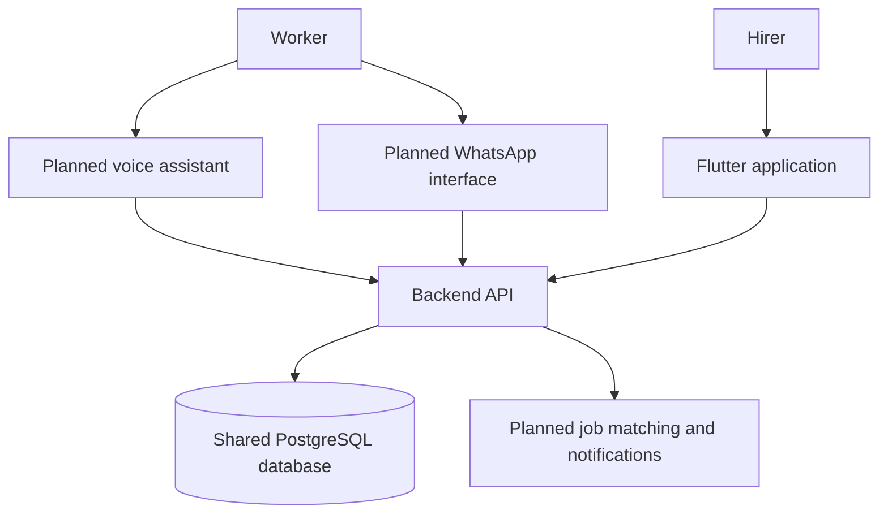

# E-Chowk

**A voice-first, AI-assisted labour platform concept designed to make work opportunities more accessible to India's informal workforce.**

E-Chowk explores how workers and people looking to hire them can connect through a simple, inclusive digital experience. The project places accessibility at the center: workers should not need to be comfortable with complex apps or forms to express their skills and find work.

> **Project status:** Work in progress. This repository contains an evolving Flutter application and supporting project materials. The complete voice, messaging, backend, and booking ecosystem is not yet implemented or production-ready. Features described as planned below are part of the product vision, not claims of completed functionality.

---

## The problem

Many workers in the informal sector may face barriers when using digital labour platforms, including:

- Limited familiarity with smartphones and app-based forms.
- Language and literacy barriers.
- Difficulty keeping profiles, skills, location, and availability up to date.
- Limited access to timely and relevant work information.

E-Chowk aims to reduce these barriers with familiar, low-friction ways to interact with a labour platform.

## Product vision

The long-term concept brings together three connected experiences backed by a shared system.

### 1. Voice assistant for workers

A worker could call a phone number and speak naturally in Hindi or a supported regional language. A voice assistant could guide the worker through tasks such as:

- Registering and sharing basic details.
- Describing skills and work experience.
- Sharing location, expected wages, and availability.
- Reviewing and confirming information before it is saved.
- Receiving information about relevant work opportunities.

The voice flow is planned; telephony and AI integrations are not represented as complete.

### 2. WhatsApp-based updates

A WhatsApp interface is envisioned for workers who prefer messaging. Potential use cases include:

- Updating availability and work location.
- Receiving job alerts and booking updates.
- Confirming or responding to relevant requests.

This is a planned integration.

### 3. Mobile experience for workers and hirers

The Flutter application is intended to support a more visual workflow for people comfortable using a mobile app. The broader product vision includes:

- Worker profiles and skill information.
- Search and discovery for hirers.
- Work requests and booking workflows.
- Ratings and reviews.
- Payment-related workflows.

The exact availability of these features depends on the current implementation. See the repository code for what is presently built.

---

## Proposed system architecture

The following is the intended architecture and technology direction. Components may change as the project evolves.

| Layer | Proposed technology | Purpose |
| --- | --- | --- |
| Mobile app | Flutter / Dart | Cross-platform application |
| Backend API | Node.js / NestJS | Business logic and integrations |
| Database | Supabase / PostgreSQL | Shared application data |
| Voice agent | Vapi.ai + Gemini Flash (to evaluate) | Conversational registration and assistance |
| Telephony | Twilio or Exotel (to evaluate) | Inbound and outbound calls |
| Messaging | Meta WhatsApp Cloud API | Worker updates and notifications |
| Authentication | Supabase Auth / OTP (to evaluate) | Secure user access |

### High-level interaction flow



This diagram describes the target design, not a deployed production system.

---

## Data model direction

A shared data layer is planned so information can be used consistently across the different interfaces.

Potential worker profile fields include:

| Field | Description |
| --- | --- |
| `id` | Unique internal identifier (UUID) |
| `phone_number` | Contact number, subject to verification and privacy controls |
| `name` | Worker name |
| `skills` | One or more skills or trade categories |
| `location` | Preferred work area |
| `expected_wage` | Expected wage and wage unit |
| `availability` | Current availability |
| `verification_status` | Verification state, if a verification process is implemented |
| `registration_source` | App, voice, or WhatsApp, when applicable |

This is a conceptual model. The actual database schema and implementation may differ. A phone number should be treated as a unique contact attribute—not as the database's primary key. Use an internal UUID as the primary key and apply appropriate authentication, consent, access controls, and data protection.

---

## Development roadmap

The roadmap is iterative and may change based on testing and feedback.

- [ ] Review and stabilize the current Flutter application.
- [ ] Define the first end-to-end use case and its acceptance criteria.
- [ ] Finalize the database model, authentication, and access rules.
- [ ] Connect the app to the backend and validate profile workflows.
- [ ] Build a small voice-registration prototype.
- [ ] Test Hindi conversation quality, confirmation, and error recovery.
- [ ] Explore WhatsApp updates and notification workflows.
- [ ] Prototype worker discovery and a basic hiring flow.
- [ ] Test with users and improve accessibility, privacy, and reliability.

## Getting started

This project uses Flutter. To explore the current application:

1. Install the [Flutter SDK](https://docs.flutter.dev/get-started/install) and the required platform tooling.
2. Clone the repository.
3. From the repository directory, install dependencies:

   ```bash
   flutter pub get
   ```

4. Run the application on a configured device or emulator:

   ```bash
   flutter run
   ```

These are standard Flutter commands. Additional setup may be required as backend services and environment configuration are developed. Do not commit API keys, credentials, or private environment files.

## Design principles

- **Accessibility first:** Keep interactions simple and support voice and local languages.
- **Respect and clarity:** Use a friendly, dignified tone and confirm important details with workers.
- **Human control:** Workers should be able to review and correct profile information.
- **Privacy by design:** Collect only necessary data and protect personal information.
- **Practical development:** Validate a small working flow before expanding the platform.
- **Honest status reporting:** Clearly distinguish implemented features from ideas and future integrations.

## Current scope and limitations

E-Chowk is an evolving project, not a launched labour marketplace. The complete voice-call registration, AI job matching, WhatsApp automation, booking, payment, identity verification, and large-scale infrastructure described in the vision are not claimed to be operational.

Any future identity verification should use a lawful, consent-based process and should not assume that Aadhaar integration is required. Likewise, commission models and scale targets need validation before being treated as product commitments.

## Contributing and feedback

Feedback on accessibility, architecture, voice interaction design, and the worker onboarding experience is welcome. If you are interested in discussing the concept or collaborating, please reach out through the repository owner’s GitHub profile.

## About

**E-Chowk** is an independent, ongoing project by **Piyush Garg**, a B.Tech student specializing in Artificial Intelligence and Data Science.

The project explores ways AI and accessible technology could help connect workers with work opportunities. It is not affiliated with or officially integrated into Digital Labour Chowk.

---

*Built as an ongoing learning and development project with a focus on digital inclusion.*
