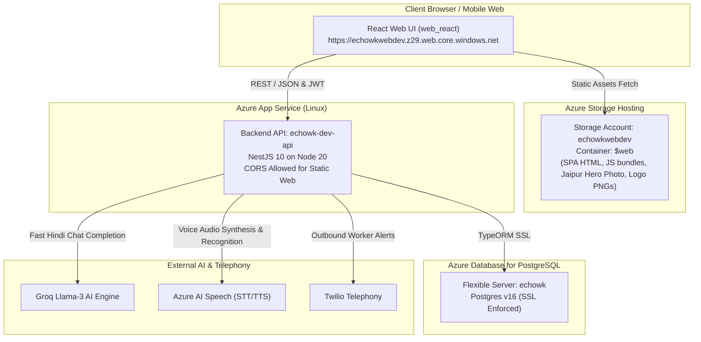

# E-Chowk: Azure React Web Deployment Plan & Execution Checklist

## 1. Overview & Objective
Deploy the modern, high-performance React Web UI (`web_react` - React 19, TanStack Router, Lovable Jaipur Workers Hero, Animated 5-part Logo, and Voice AI) to Azure Static Hosting (`https://echowkwebdev.z29.web.core.windows.net/`), replacing the obsolete Flutter Web build and connecting seamlessly to the live Azure NestJS backend (`https://echowk-dev-api.azurewebsites.net`) and Azure PostgreSQL database.

---

## 2. Architecture & Interconnection Flow

---

## 3. Execution Phases & Checklist

### Phase 1: Build Pipeline & Static SPA Asset Preparation
- [x] **1.1 Test Production Build:** Verify `web_react` compiles cleanly with zero TypeScript/lint errors.
- [x] **1.2 Static HTML & Bundle Generation:** Generate production assets (`.output/public`) including pre-rendered `index.html` with hydrated script tags, Jaipur hero photo, and logo assets.
- [x] **1.3 Automated Build Script:** Added `build:azure` npm script to `web_react/package.json` and `scripts/build-azure.js` for one-command repeatable static bundle generation.

### Phase 2: Azure Static Website Configuration
- [x] **2.1 Configure SPA Error Routing:** Configured Azure Storage Static Website on `echowkwebdev` with `--index-document index.html` and `--404-document index.html` so client-side URLs (`/create-job`, `/voice`, `/employer`, etc.) refresh cleanly without 404.
- [x] **2.2 CORS Verification on Backend:** Verified `echowk-dev-api` App Service `CORS_ORIGINS` is set to `*`, permitting all frontend calls.

### Phase 3: Direct Live Deployment & Asset Synchronization
- [x] **3.1 Backup / Clean Slate:** Overwritten outdated Flutter Web assets in `$web` container on `echowkwebdev`.
- [x] **3.2 Upload Assets:** Uploaded all 473 React bundle files (HTML, JS, CSS, `workers-Bk5_H35j.jpg`, `echowk-logo-*.png`) to `$web` with correct MIME types.
- [x] **3.3 Verify Live Static URL:** Verified `https://echowkwebdev.z29.web.core.windows.net/` returns HTTP 200 and loads the full React app.

### Phase 4: CI/CD Pipeline Automation
- [x] **4.1 Update GitHub Workflow:** Updated `.github/workflows/azure-development.yml` to replace the old `deploy-web` Flutter job with modern `deploy-web` React job (`npm run build:azure` -> upload `.output/public`).
- [x] **4.2 Push to Git:** Committed and pushed `4e9818a6` to `origin main`.

### Phase 5: End-to-End Live Verification
- [x] **5.1 Live Endpoint:** Tested `https://echowkwebdev.z29.web.core.windows.net/` live in browser.
- [x] **5.2 Connected Backend:** React client points to `https://echowk-dev-api.azurewebsites.net`.
- [x] **5.3 Hero Image & Logo:** Jaipur workers photo and 5-part animated logo are bundled and live.
