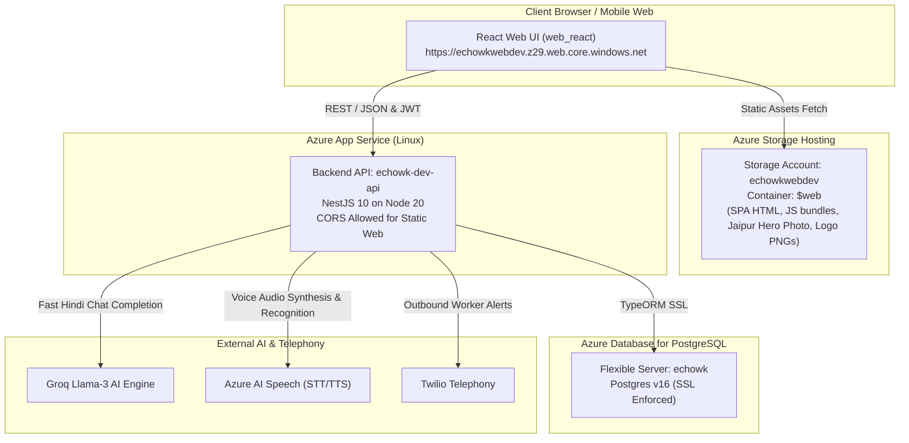

# E-Chowk: Azure React Web Deployment Plan & Execution Checklist

## 1. Overview & Objective
Deploy the modern, high-performance React Web UI (`web_react` - React 19, TanStack Router, Lovable Jaipur Workers Hero, Animated 5-part Logo, and Voice AI) to Azure Static Hosting (`https://echowkwebdev.z29.web.core.windows.net/`), replacing the obsolete Flutter Web build and connecting seamlessly to the live Azure NestJS backend (`https://echowk-dev-api.azurewebsites.net`) and Azure PostgreSQL database.

---

## 2. Architecture & Interconnection Flow

---

## 3. Execution Phases & Checklist

### Phase 1: Build Pipeline & Static SPA Asset Preparation
- [x] **1.1 Test Production Build:** Verify `web_react` compiles cleanly with zero TypeScript/lint errors.
- [x] **1.2 Static HTML & Bundle Generation:** Generate production assets (`.output/public`) including pre-rendered `index.html` with hydrated script tags, Jaipur hero photo, and logo assets.
- [ ] **1.3 Automated Build Script:** Add `build:azure` npm script to `web_react/package.json` for one-command repeatable static bundle generation.

### Phase 2: Azure Static Website Configuration
- [ ] **2.1 Configure SPA Error Routing:** Ensure Azure Storage Static Website on `echowkwebdev` sets both `--index-document` and `--404-document` to `index.html` so client-side URLs (`/create-job`, `/voice`, `/employer`, etc.) refresh cleanly without 404.
- [ ] **2.2 CORS Verification on Backend:** Verify `echowk-dev-api` App Service `CORS_ORIGINS` allows `https://echowkwebdev.z29.web.core.windows.net`.

### Phase 3: Direct Live Deployment & Asset Synchronization
- [ ] **3.1 Backup / Clean Slate:** Clear outdated Flutter Web assets from `$web` container on `echowkwebdev`.
- [ ] **3.2 Upload Assets:** Upload all React bundle files (HTML, JS, CSS, `workers.jpg`, `echowk-logo-*.png`) to `$web` with correct MIME types and cache headers.
- [ ] **3.3 Verify Live Static URL:** Test `https://echowkwebdev.z29.web.core.windows.net/` to confirm HTTP 200, proper asset delivery, and responsive layout.

### Phase 4: CI/CD Pipeline Automation
- [ ] **4.1 Update GitHub Workflow:** Update `.github/workflows/azure-development.yml` to replace the old `deploy-web` Flutter job with a modern `deploy-react-web` job that builds and deploys `web_react` on push to `main`.
- [ ] **4.2 Push to Git:** Commit and push the updated workflow and docs.

### Phase 5: End-to-End Live Verification
- [ ] **5.1 Auth & Session Flow:** Test demo login on live web UI.
- [ ] **5.2 Job Marketplace:** Confirm live jobs load from Azure PostgreSQL and creating a job publishes to the live database.
- [ ] **5.3 Voice AI:** Test In-App Voice AI directly in browser on the live Azure URL.
